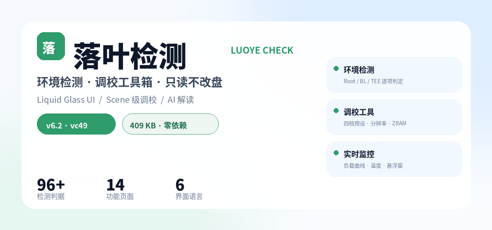
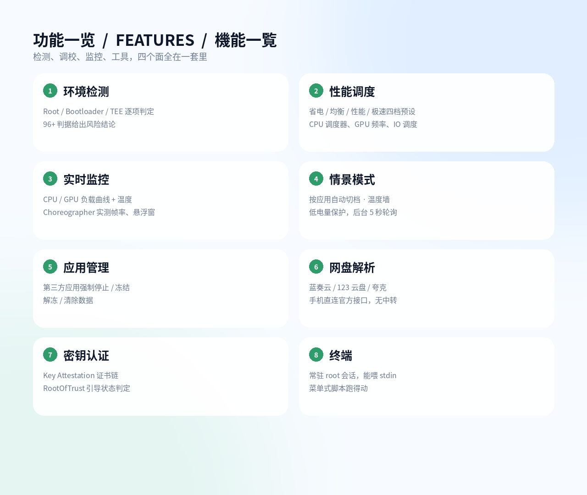
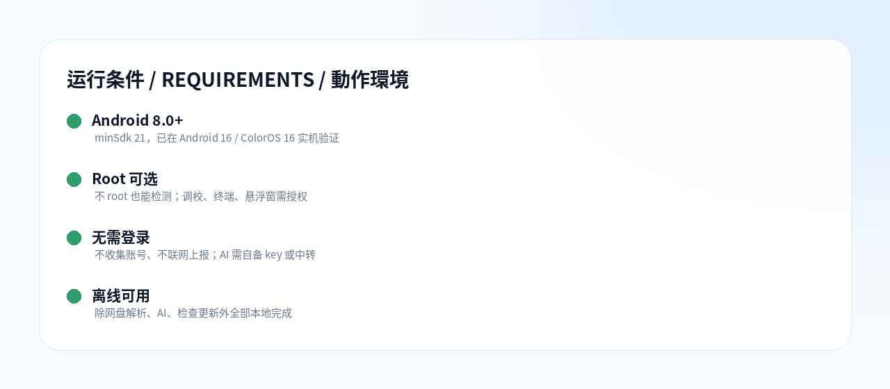

# 落叶检测 · LUOYE CHECK

**环境检测 / 调校工具箱 / 实时监控，一个包全给你**

[-2F9C6B?style=flat-square)](https://github.com/luoye888-svg/luoye-check/releases/latest)

[-4FA8FF?style=flat-square)](#)

[简体中文](#简体中文) ｜ [English](#english) ｜ [日本語](#日本語)

[下载最新版](https://github.com/luoye888-svg/luoye-check/releases/latest) ｜ [更新日志](https://github.com/luoye888-svg/luoye-check/releases)

---

## 简体中文

### 这是什么

落叶检测是一个**纯 Java、零第三方依赖**的安卓工具，把「环境检测」「性能调校」「实时监控」「实用工具」四件事压在一个 409 KB 的包里。所有频率、温度、GPU 负载都是**运行时现场读 sysfs**，不带任何机型配置库，所以装在哪台机器都按那台机器的真实节点来。

### 功能

| 模块 | 能做什么 |
|---|---|
| 环境检测 | Root、Bootloader、TEE、密钥认证逐项判定，96+ 判据给出风险结论，不给「无法判定」这种废话 |
| 性能调度 | 省电/均衡/性能/极速四档预设；CPU 调度器与核心开关、GPU 频率、温控热区、IO 调度、分辨率与 DPI、ZRAM 压缩算法、swap 文件 |
| 实时监控 | CPU/GPU 负载曲线、频率、最热区温度、Choreographer 实测帧率；悬浮窗可压在其他应用上 |
| 情景模式 | 按应用包名自动切档、温度墙自动降档、低电量保护，后台 5 秒轮询 |
| 应用管理 | 第三方应用强制停止 / 冻结 / 解冻 / 清除数据 |
| 网盘解析 | 蓝奏云、123 云盘直链解析，夸克列目录；手机直连官方接口，不经过任何中转 |
| 密钥认证 | Key Attestation 证书链、RootOfTrust、引导状态，仿 Key Attestation 布局 |
| 终端 | 常驻 root 会话，能喂 stdin，菜单式脚本（如驱动加载器）跑得动 |
| AI 解读 | 检测完直接让 AI 分析报告给处理顺序；支持自填中转地址与令牌，key 可以不进包 |
| 换肤 | Liquid Glass 液态玻璃：折射放大、镜面高光、边缘色散、选中透镜；支持自定义背景图 |
| 多语言 | 简体中文 / 繁體中文 / English / 日本語 / Tiếng Việt / Português (Brasil) |

### 安装

1. 到 [Releases](https://github.com/luoye888-svg/luoye-check/releases/latest) 下 `luoye-6.2.apk`
2. 直接安装（签名固定，覆盖安装不用卸载）
3. 首次打开允许「未知来源安装」，需要调校/终端时再授权 root

App 内置强制更新：启动时读 `update.json`，有新版本会弹窗，强制更新锁返回键。

### 加入群聊

微信群 **「落叶的小窝」**，版本更新、功能许愿、报 bug 都在这儿。二维码 7 天过期，过期后看仓库根目录的 [group-qr.png](https://github.com/luoye888-svg/luoye-check/blob/main/group-qr.png)，我会换新的。

### 源码

源码包：[luoye-check-source-6.3.zip](https://github.com/luoye888-svg/luoye-check/raw/main/luoye-check-source-6.3.zip)

用 Android Studio 打开**含 `settings.gradle` 的那层目录**即可（包内自带 Gradle wrapper、AGP 8.6.1）。
不包含签名密钥 `luoye.jks`，自己签的包需要把 `Detect.EXPECTED_CERT_SHA256` 改成自己的证书指纹。

### 隐私

- 不收集账号，不上报任何设备信息，没有埋点
- 检测结果只存在本机，不自动上传
- AI 解读是把检测文本发到你填的接口（默认 DeepSeek），用不用由你决定
- 网盘解析是从你手机直接请求网盘官方接口

### 免责

改调度、改分辨率、改 DPI、建 swap 都可能让设备不稳定，**后果自负**。所有分区操作只读，不做擦除。刷机前请自行备份。

---

## English

### What is it

**Luoye Check** is a pure-Java Android tool with **zero third-party dependencies**, packing environment inspection, performance tuning, live monitoring and utilities into a single **409 KB** APK. Frequencies, temperatures and GPU load are read from sysfs at runtime — no per-device database, so it adapts to whatever phone it runs on.

### Features

| Module | What it does |
|---|---|
| Environment check | Root / Bootloader / TEE / key attestation verdicts from 96+ checks, no "unknown" cop-outs |
| Tuning | Four presets (power-save / balanced / performance / extreme); CPU governor, core toggles, GPU freqs, thermal zones, IO scheduler, resolution & DPI, ZRAM algorithm, swap file |
| Live monitor | CPU/GPU load curves, clocks, hottest thermal zone, real frame rate via Choreographer, floating overlay |
| Scenarios | Auto-switch profile by app package, thermal wall, low-battery guard, 5 s polling |
| App manager | Force-stop / freeze / unfreeze / clear data for third-party apps |
| Cloud link parser | Lanzou & 123pan direct links, Quark directory listing — requested straight from your phone, no relay server |
| Key attestation | Certificate chain, RootOfTrust and boot state, Key Attestation style layout |
| Terminal | Persistent root session that accepts stdin, so menu-driven scripts work |
| AI analysis | Send the report to an LLM for a prioritized fix list; custom endpoint and token supported, the key can stay out of the APK |
| Skin | Liquid Glass: refraction, specular highlight, edge dispersion, travelling selection lens; custom wallpaper |
| Languages | 简体中文 / 繁體中文 / English / 日本語 / Tiếng Việt / Português (Brasil) |

### Install

Download `luoye-6.2.apk` from [Releases](https://github.com/luoye888-svg/luoye-check/releases/latest), install over the old version (signature is stable). Root is optional — only tuning, terminal and the overlay need it.

### Join the group

WeChat group **"落叶的小窝"** — release news, feature requests and bug reports. The QR code expires every 7 days; when it does, grab the latest from [group-qr.png](https://github.com/luoye888-svg/luoye-check/blob/main/group-qr.png).

### Source

Source package: [luoye-check-source-6.3.zip](https://github.com/luoye888-svg/luoye-check/raw/main/luoye-check-source-6.3.zip)

Open the folder that contains `settings.gradle` in Android Studio — the Gradle wrapper and AGP 8.6.1 are included. The signing key `luoye.jks` is **not** shipped; if you sign with your own key, update `Detect.EXPECTED_CERT_SHA256` accordingly.

### Privacy

No account, no telemetry, no device reporting. Detection results stay on-device. AI is opt-in and goes to the endpoint you configure.

### Disclaimer

Changing schedulers, resolution, DPI or creating swap can destabilize your device — **use at your own risk**. Partition tools are read-only.

---

## 日本語

### これは何か

**落叶检测（Luoye Check）** は、サードパーティ依存ゼロ・純 Java の Android ツールです。環境検査・チューニング・リアルタイム監視・ユーティリティを **409 KB** の 1 パッケージにまとめました。周波数・温度・GPU 負荷は実行時に sysfs から直接読むため、機種データベースを持たず、どの端末でも実機のノードに合わせて動きます。

### 機能

| モジュール | 内容 |
|---|---|
| 環境検査 | Root / Bootloader / TEE / キー認証を 96 以上の項目で判定。「不明」で逃げません |
| チューニング | 省電力・バランス・性能・極速の 4 プリセット。CPU ガバナー、コア制御、GPU 周波数、温度ゾーン、IO スケジューラ、解像度・DPI、ZRAM 圧縮、swap ファイル |
| リアルタイム監視 | CPU/GPU 負荷グラフ、クロック、最高温度、Choreographer による実測 fps、オーバーレイ表示 |
| シーン設定 | アプリごとに自動でプロファイル切替、温度上限、低バッテリー保護、5 秒ポーリング |
| アプリ管理 | サードパーティアプリの強制停止・凍結・解除・データ消去 |
| クラウドリンク解析 | 藍奏雲・123雲盤の直リンク、Quark の一覧取得。端末から直接 API を叩き、中継サーバーなし |
| キー認証 | 証明書チェーン、RootOfTrust、起動状態を Key Attestation 風の画面で表示 |
| ターミナル | 常駐 root セッションで stdin を渡せるため、メニュー式スクリプトも動作 |
| AI 解説 | 検査結果を LLM に渡して対処順を受け取る。独自エンドポイントとトークンに対応、key を APK に同梱しない運用も可 |
| 外観 | Liquid Glass（屈折・鏡面ハイライト・縁の色分散・選択レンズ）、背景画像のカスタム |
| 言語 | 简体中文 / 繁體中文 / English / 日本語 / Tiếng Việt / Português (Brasil) |

### インストール

[Releases](https://github.com/luoye888-svg/luoye-check/releases/latest) から `luoye-6.2.apk` を取得して上書きインストール（署名は固定）。Root は任意で、チューニング・ターミナル・オーバーレイのみ必要です。

### グループに参加

WeChat グループ **「落叶的小窝」**。更新情報・要望・バグ報告はこちらへ。QR コードは 7 日で失効します。失効後は [group-qr.png](https://github.com/luoye888-svg/luoye-check/blob/main/group-qr.png) の最新版をご利用ください。

### ソース

ソースパッケージ：[luoye-check-source-6.3.zip](https://github.com/luoye888-svg/luoye-check/raw/main/luoye-check-source-6.3.zip)

`settings.gradle` がある階層を Android Studio で開いてください（Gradle wrapper と AGP 8.6.1 同梱）。署名鍵 `luoye.jks` は含みません。自前の鍵で署名する場合は `Detect.EXPECTED_CERT_SHA256` を自分の証明書指纹に変更してください。

### プライバシー

アカウント収集・テレメトリ・端末情報の送信は一切ありません。検査結果は端末内に留まります。AI は任意で、設定したエンドポイントにのみ送信します。

### 免責

スケジューラ・解像度・DPI・swap の変更は端末を不安定にし得ます。**自己責任で**。パーティション系は読み取り専用です。

---

Made by 落叶逸（抖音同号）

